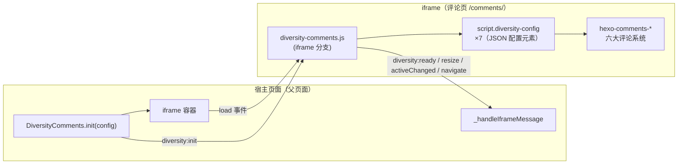

# 📖 一、前言

前两篇分别讲了 [快速上手](../../../../../2026/10/28/hexo/hexo-diversity-comments-quickstart/) 与 [配置与 API](../../../../../2026/10/28/hexo/hexo-diversity-comments-config-api/)。本篇聊最有意思的部分：**SDK 内部如何运转**，以及评论区里最容易翻车的环节——**OAuth 登录**。

读完本篇，你能理解：一份 JS 如何在两个上下文里工作、配置如何跨越 iframe 边界传递、iframe 高度为何能无跳变同步，以及四大 GitHub 系评论系统（Utterances / Giscus / Gitalk / Gitment）的 OAuth 难题是怎么解的。

<!-- more -->

# 🏗 二、总体架构



## 同一份 JS，两种行为

`diversity-comments.js` 顶部先判定运行上下文：

```javascript
var isInIframe = (function() {
    try {
        return global.self !== global.top && global.parent !== global.self;
    } catch (e) {
        return true;    // 跨域访问 top 被拒 → 一定在 iframe 内
    }
})();
```

- **父页面**：导出 `DiversityComments` 全局对象，负责创建 iframe、发送配置、处理回调
- **iframe 内**：接收配置、写配置元素、监听高度、上报状态，**然后 `return`，不执行父页逻辑**

# 🔧 三、核心机制一：diversity-config 配置元素

iframe 内的评论系统不直接接收 postMessage，而是读取页面里的 JSON 配置元素：

```html
<script class="diversity-config" data-name="giscus" type="application/json">
    { "enable": true, "repo": "...", ... }
</script>
```

SDK 在 iframe 侧维护这 7 个元素（`comments` + 六个系统），职责分工：

| 函数 | 职责 |
|------|------|
| `parseConfigElements()` | 读取所有配置元素，按 `data-name` 解析为对象 |
| `updateConfigElement(name, cfg)` | deepMerge 后回写指定元素；不存在则新建 |
| `ensureCommentConfigs()` | 缺失的元素用默认值补齐 |
| `applyCommentsConfig(cfg)` | 把父页面传入的配置合并进各元素 |
| `resolvePageIdentifier(data)` | 按 pageId 规则把关键词模式翻译成真实标识 |
| `applyCommonLang(data)` | 把 `comments.lang` 统一写入各系统语言字段 |

## diversity:init 初始化时序

iframe 的 `load` 事件触发后，父页面发送 `diversity:init`，iframe 侧按固定顺序处理：

```
 1. processPendingOAuth()          处理刷新遗留的 OAuth code（Gitalk/Gitment）
 2. 记录 parentUrl → localStorage  供 OAuth 回调重定向找回父页面
 3. setupIframeStyles()            body/container 宽度 100%
 4. ensureCommentConfigs()         补齐缺失配置元素
 5. applyCommentsConfig()          合并父页面配置
 6. resolvePageIdentifier()        解析页面标识
 7. applyCommonLang()              应用统一语言
 8. switchDisplayMode(style)       tabs / dropdown / both 导航切换
 9. updateSystemVisibility()       按 enable 隐藏未启用系统
10. 切换 dark-theme class          darkMode: auto 跟随 prefers-color-scheme
11. activateCommentTab(active)     storage 开启时优先取 localStorage 记忆
12. reinitComments()               派发 page:loaded 事件，触发评论系统加载
13. postToParent(diversity:ready)  通知父页面就绪（携带高度与 active）
14. watchActiveTab()               监听 iframe 内 tab/dropdown 切换
```

> 关键细节：iframe 内在**收到父页面配置之前**，会在捕获阶段拦截第一次 `page:loaded` 事件（`stopImmediatePropagation`），防止评论系统在拿到配置前就带着默认值渲染。

# 📨 四、核心机制二：postMessage 消息协议

所有消息都是 `{ type: string, ... }` 结构。调试时可监听：

```javascript
window.addEventListener('message', function(e) { console.log('[msg]', e.data); });
```

## 父页面 → iframe

| type | 载荷 | 作用 |
|------|------|------|
| `diversity:init` | `config`, `parentUrl`, `parentPathname`, `parentTitle`, `parentOgTitle` | 注入完整配置与父页面信息 |
| `diversity:switchTo` | `name` | 切换评论系统 |
| `diversity:switchStyle` | `style` | 切换导航模式 |
| `diversity:setColorScheme` | `scheme` | 切换明暗模式 |
| `diversity:refresh` | — | 刷新当前评论 |
| `diversity:getHeight` | — | 主动查询高度 |

## iframe → 父页面

| type | 载荷 | 作用 |
|------|------|------|
| `diversity:loaded` | `height` | iframe DOMContentLoaded（早于 ready） |
| `diversity:ready` | `height`, `active` | 初始化完成 |
| `diversity:resize` | `height` | 高度变化，父页面据此调整 iframe 高度 |
| `diversity:activeChanged` | `active` | 用户在 iframe 内切换了评论系统 |
| `diversity:navigate` | `url` | 评论正文中的链接被点击，父页面在新标签页打开 |
| `diversity:error` | `message` | 错误上报 |

另有第三方消息 `diversity:gitalk:oauth` / `diversity:gitment:oauth`（及 `:hint` 变体），由 callback.html 发给父页面、父页面**原样转发**给 iframe，见下文 OAuth 部分。

# 🔄 五、更多核心机制

## 自动高度同步（双保险）

iframe 无法直接感知父页面布局，高度同步完全靠 iframe 侧上报：

1. **MutationObserver**：监听 `document.body` 的 DOM 变化，高度差 **> 10px** 时上报
2. **setInterval 500ms**：定时轮询兜底（捕获 Observer 漏掉的样式型变化），高度差 **> 5px** 时上报

父页面收到 `diversity:resize` 后直接设置 `iframe.style.height`，评论内容增长（展开长评论、翻页）时无跳变。

## 明暗模式流转

```
darkMode 配置 / setColorScheme(scheme)
        │
        ▼
iframe 侧: html.classList.toggle('dark-theme', isDark)
        │      （auto 时用 matchMedia('(prefers-color-scheme: dark)') 判定）
        ▼
派发 color-scheme:refresh 事件 → 各评论系统刷新配色
```

## 懒加载与选择记忆

- **懒加载**（`lazyload: true`）：进入视口的评论面板才开始加载对应系统资源
- **选择记忆**（`storage: true`）：任何一次切换都写入 `localStorage['selected_comment']`；下次初始化时该值**优先于** `comments.active` 生效

## 安全与自愈设计

| 机制 | 说明 |
|------|------|
| 链接拦截 | iframe 内评论正文的链接点击被拦截并转为 `diversity:navigate`，由父页面 `window.open(url, '_blank', 'noopener,noreferrer')` 打开，避免在 iframe 内导航走丢页面 |
| token 自愈 | iframe 启动时校验 Gitalk/Gitment token：长度 < 20 直接清除；再异步调 `GET api.github.com/user`，401 则清除 |
| 脚本 origin 捕获 | SDK 加载瞬间用 `document.currentScript` 记下部署地址，供 `server` 未传时使用 |
| OAuth pending 清理 | 刷新/中断遗留的 `diversity_oauth_pending` 在下一次 `diversity:init` 时统一处理或清除 |

# 🔐 六、OAuth 登录实战

评论区里「能用 GitHub 账号发言」是最容易出问题的环节——四大 GitHub 系评论系统在 iframe 沙箱里各有各的坑：

- **Gitalk**：未配置 `proxy` 时默认在 iframe 内直接跳转 GitHub OAuth，被 iframe 的安全策略阻止
- **Gitment**：`window.open()` 默认依赖的公共代理 `gh-oauth.imsun.net` 已失效
- **Giscus / Utterances**：OAuth 回调会把**整个页面**重定向走；在 iframe 内发生时页面会"卡死"在回调页
- **跨域分区存储**：宿主页与评论服务不同域时，iframe 属于第三方分区，localStorage 写入的内容 OAuth 回调页可能读不到

SDK 按系统特性分成两套方案：

| 方案 | 适用系统 | 核心思路 |
|------|----------|----------|
| A. 回调重定向 | Giscus / Utterances | 顺着各系统 client.js 的原生逻辑走，把"迷路"的回调页面**重定向回父页面**，session 经 URL 回传 |
| B. 统一登录劫持 | Gitalk / Gitment | 完全接管登录按钮：弹窗授权 → callback.html 接收 code → postMessage 回传 → iframe 内换 token |

## 方案 A：Giscus / Utterances 回调重定向

这两个系统的 client.js 自己管理 OAuth（写 `localStorage['giscus-session']` / `['utterances-session']`）。SDK 只做一件事：**在 OAuth 回调落地时把用户带回父页面**。

```
1. iframe 内点击登录 → client.js 跳转 GitHub OAuth（整个 iframe 页面被重定向）
2. GitHub 授权后重定向回 /comments/?giscus=<session>（顶层页面，不在 iframe 里）
3. SDK 的 detectOAuthCallback()（最先执行，早于 iframe 判定）：
   ├─ 把 session 写入 localStorage（giscus 需 JSON 格式；utterances 为纯字符串）
   ├─ 顶层页面：从 URL ?parent= 参数找回父页面地址（兜底读 localStorage）
   └─ location.href = 父页面地址（session 附在 hash 上：#giscus=xxx&utterances=yyy）
4. 父页面加载 → 读取 hash 中的 session 并清理 hash
5. 重建 iframe：/comments/?parent=...&giscus=xxx → iframe 内 client.js 正常续上登录态
```

两个关键设计点：

- **session 走 URL hash 而非 localStorage**：跨域分区存储下，顶层回调页写的 localStorage 与 iframe 读到的不是同一份数据，所以把 session 拼在父页面 URL 的 hash 上传递
- **`parent` 参数**：`diversity:init` 时 iframe URL 就带上了 `parent=<父页面完整URL>`，回调落地页据此精确回到「发起评论的那个页面」，多标签页互不干扰

**Giscus 白名单（必做）**：须把宿主网站域名加入评论仓库根目录的 `giscus.json`：

```json
{
  "origins": [
    "http://localhost:4000",
    "https://your-domain.com"
  ]
}
```

## 方案 B：Gitalk / Gitment 统一登录劫持

SDK 内置一个 OAuth Hijack 模块，**同时运行在父页面与 iframe 两侧**（父页面侧只负责转发消息）：

```
1. iframe 内 page:loaded 后，SDK 用 MutationObserver 盯住 .gitalk-wrap / .gitment-wrap
2. 扫描登录按钮，在【捕获阶段】拦截 click（不改 DOM，防止破坏框架渲染）：
   └─ 已有有效 token → 放行原生行为；否则 preventDefault
3. window.open 弹窗 GitHub OAuth 授权页（880×700）
   ├─ Gitalk scope: 'repo,read:user'　Gitment scope: 'public_repo'
   └─ redirect_uri 默认 https://<评论服务域名>/callback.html?system=gitalk|gitment
4. GitHub 授权后落到 callback.html
5. callback.html 通过 window.opener.postMessage 把 code/token 发回父页面
6. 父页面把消息【原样转发】给 iframe
7. iframe 侧接收并换 token：
   ├─ 消息带完整 token → 直接写入 localStorage
   └─ 只有 code → POST 到配置的 proxy
       body: { code, client_id, client_secret }
       响应取 access_token / accessToken / token 任一字段
       成功 → 写入 localStorage → 派发 page:loaded 让评论系统重新加载
       （不整页 reload，避免 iframe 失联）
```

兜底机制：postMessage 不可用的环境（微信内置浏览器等），callback.html 改写 `localStorage['diversity_oauth_pending']`，iframe 通过 **storage 事件**收到并处理。

### 接入方需要做的事

1. **GitHub OAuth App**：callback URL 填评论服务域名的 `/callback.html`
2. **配置 proxy**：一个能接收 `POST {code, client_id, client_secret}` 并向 GitHub 换取 `access_token` 的服务端点（client_secret 不能出现在前端，必须由服务端代理）：

```javascript
gitalk: {
    enable: true,
    repo: 'comment-repo',
    client_id: 'YOUR_CLIENT_ID',
    client_secret: 'YOUR_CLIENT_SECRET',
    proxy: 'https://your-oauth-proxy.com/api/auth'
}
```

3. **弹窗白名单**：弹窗被浏览器拦截时 SDK 会提示允许弹窗

### callback.html 的职责边界

callback.html 只做「**接收 GitHub 重定向、托管 code、回传给 opener**」这一件事；**token 交换完全在 iframe 侧完成**——只有 iframe 侧能安全读到 `client_secret` 与 proxy 配置，凭据不出域。

## 遗留问题自愈

| 场景 | 处理 |
|------|------|
| iframe 刷新时 token 交换被打断 | `diversity_oauth_pending` 里遗留的 code 在下一次 `diversity:init` 时续处理 |
| 历史遗留：code 被当 token 存下 | 启动校验长度 < 20 的 token 直接清除 |
| token 已失效（撤销/过期） | 异步调 `GET api.github.com/user`，401 自动清除 |
| 交换失败 | code 不会被当 token 存储（code 不是有效 token），并清空 pending |

## OAuth 排查清单

| 现象 | 排查方向 |
|------|----------|
| 点登录没反应 | 是否命中劫持按钮（`.gt-btn-login` / `.gitment-editor-login-link`）；控制台看 `[Diversity OAuth]` 日志 |
| 弹窗打不开 | 浏览器弹窗拦截，允许弹窗或加白名单 |
| 弹窗授权后无后续 | redirect_uri 与 OAuth App callback URL 是否一致；`proxy` / `client_id` / `client_secret` 是否齐全 |
| Giscus 授权失败 | 宿主域名是否已加入 `giscus.json` 的 `origins` |
| 登录后状态丢失（跨域场景） | 确认使用 SDK 内置流程（hash 回传机制），未自造回调逻辑 |

# 📚 七、小结

至此 SDK 文档三部曲完结：

1. [快速上手](../../../../../2026/10/28/hexo/hexo-diversity-comments-quickstart/)：三步接入、跨域接入
2. [配置与 API 详解](../../../../../2026/10/28/hexo/hexo-diversity-comments-config-api/)：全部配置项、pageId 解析规则、API 速查
3. 本篇：iframe 沙箱机制、消息协议、OAuth 两套方案

有任何问题欢迎在下方评论区留言（没错，评论区本身就是 Diversity Comments SDK 驱动的 😉）。
