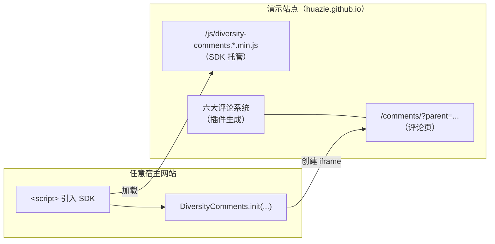

# 📖 一、前言

之前 Huazie 用 [8 篇文章](../../../../../2026/10/27/hexo/hexo-generator-comments/) 依次介绍了 [diversity-plugins](https://github.com/huazie/diversity-plugins) 插件家族的核心 [hexo-generator-comments](../../../../../2026/10/27/hexo/hexo-generator-comments/) 与六大评论插件（Utterances / Gitalk / Giscus / Twikoo / Gitment / Waline）。

不过那套插件方案是 **Hexo 专属**的。如果你用的是其他博客系统，甚至是纯手写的网站，想要一套"开箱即用"的多评论方案怎么办？

这就是本篇主角 —— **Diversity Comments SDK**：任意网站只需引入一个 `<script>`、调用一次 `DiversityComments.init()`，即可获得功能完整的评论区，随时切换六大评论系统。

<!-- more -->

# 🧩 二、SDK 是什么

一句话概括：

> 一套 API 集成六大评论系统（Utterances / Gitalk / Giscus / Twikoo / Gitment / Waline），基于 iframe 沙箱隔离，开箱即用的多评论方案。

| 特性 | 说明 |
|------|------|
| **六大评论系统** | Utterances / Gitalk / Giscus / Twikoo / Gitment / Waline 一站集成 |
| **iframe 沙箱隔离** | 评论区运行在独立 iframe 中，不影响宿主页面样式与脚本 |
| **实时切换** | API 一行代码切换评论系统，支持 Tab、Dropdown 以及两者共存（Both）三种导航模式 |
| **明暗模式** | `light` / `dark` / `auto` 三种模式，自动跟随系统或手动切换 |
| **懒加载 & 记忆** | 进入视口才加载评论，localStorage 记住用户上次选择的评论系统 |
| **自动高度** | MutationObserver + 定时器双保险，iframe 高度实时同步到父页面 |

## 与 diversity-plugins 的关系

两者分工明确：

| 项目 | 职责 |
|------|------|
| [diversity-plugins](https://github.com/huazie/diversity-plugins) | npm 插件仓库。`hexo-generator-comments` 生成 `/comments/` 评论页骨架，`hexo-comments-*` 六个插件各自渲染对应评论系统 |
| **diversity-comments-site** | 把上述插件跑起来部署到线上的 **演示站点**；同时托管 SDK 核心，供外部网站远程引入 |



# 🚀 三、三步接入

## Step 1 — 放置容器

```html
<div id="diversity-comments"></div>
```

容器 id 可自定义，与 Step 3 中 `container` 字段对应即可。SDK 会**清空容器内容**并把 iframe 挂进去。

## Step 2 — 引入 SDK

```html
<script src="https://huazie.github.io/js/diversity-comments.1.0.0.min.js"></script>
```

路径**带版本号**，升级 SDK 时改版本号即可，旧版本缓存天然隔离；也可以把产物下载后自托管。

## Step 3 — 初始化

```javascript
DiversityComments.init({
    container: '#diversity-comments',
    comments: {
        pageId: '/comments',       // 页面唯一标识（也可不传，见下文）
        style: 'tabs',             // tabs / dropdown / both
        active: 'utterances',      // 默认激活的评论系统
        lazyload: true,            // 进入视口才加载评论
        storage: true,             // 记住用户上次选择
        darkMode: 'auto',          // light / dark / auto
        lang: 'zh-CN'              // 统一覆盖各系统语言（Utterances 除外）
    },
    utterances: {
        enable: true,
        repo: 'user/repo',
        issue_term: 'pathname'
    },
    giscus: {
        enable: true,
        repo: 'user/repo',
        repo_id: 'R_xxx',
        category: 'Announcements',
        category_id: 'DIC_xxx',
        mapping: 'pathname'
    },
    onReady: function(iframe, active) {
        console.log('评论已就绪，当前:', active);
    },
    onActiveChange: function(active) {
        console.log('切换到:', active);
    },
    onError: function(msg) {
        console.error('加载失败: ' + msg);
    }
});
```

初始化后 SDK 会在容器内创建 iframe 指向 `server + '/comments/?parent=<当前页URL>'`，iframe 加载完成后通过 `postMessage` 把完整配置注入评论页（内部机制见 [运行原理篇](../../../../../2026/10/28/hexo/hexo-diversity-comments-internals/)）。

## pageId 可以不传

`comments.pageId` 未传时，各评论系统按自身的定位模式自动从父页面取值：

| 系统 | 默认模式 | 取值来源 |
|------|----------|----------|
| Utterances / Gitalk / Gitment | `issue_term: 'pathname'` | 父页面 `location.pathname` |
| Giscus | `mapping: 'pathname'` | 父页面 `location.pathname` |
| Waline | `path: 'pathname'` | 父页面 `location.pathname` |
| Twikoo | `path` 为空 | 父页面 `location.pathname` |

需要跨设备一致标识时（如 SPA 改写了 pathname）再显式传 `pageId`，此时**所有系统统一使用该值**。完整解析规则见 [配置与 API 篇](../../../../../2026/10/28/hexo/hexo-diversity-comments-config-api/)。

# 💡 四、推荐做法：getDefaultConfig()

启用多个评论系统时，推荐先获取默认配置再覆盖所需字段。这样配置结构与 SDK 默认值保持同步——SDK 升级新增字段时不用回头改自己的代码：

```javascript
var config = DiversityComments.getDefaultConfig();   // 深拷贝，不污染内部默认值
config.comments.pageId = '/posts/hello-world';
config.utterances.enable = true;
config.utterances.repo = 'user/repo';
// ... 其他配置
DiversityComments.init(config);
```

# 🌐 五、跨域接入

SDK 与评论页**不要求同域**。SDK 从哪个域加载，iframe 就指向哪个域：

| 场景 | server 的取值 |
|------|---------------|
| 未传 `server` | 自动取**脚本加载地址的 origin**（SDK 加载时通过 `document.currentScript` 捕获），兜底当前页面 origin |
| 显式传 `server` | 以传入值为准，如 `server: 'https://huazie.github.io'` |

把 SDK 部署在 `https://comments.example.com`、博客跑在 `https://blog.example.com`，初始化时传 `server` 即可。

## 两个已知限制

1. **第三方 iframe 的 localStorage 分区存储**：跨域时 iframe 内写不下能被 OAuth 回调读到的 localStorage，SDK 已通过 URL hash 回传 session 解决（详见 [运行原理与 OAuth 篇](../../../../../2026/10/28/hexo/hexo-diversity-comments-internals/)），接入方无需处理
2. **Giscus 白名单**：必须把**宿主网站域名**加入评论仓库根目录的 `giscus.json`，否则 OAuth 授权会失败：

```json
{
  "origins": [
    "http://localhost:4000",
    "https://your-domain.com"
  ]
}
```

# ✅ 六、接入验证清单

| 检查项 | 方法 |
|--------|------|
| 容器存在 | 控制台无 `[DiversityComments] 未找到挂载容器元素` 报错 |
| SDK 加载 | 控制台执行 `DiversityComments.version` 应输出 `'1.0.0'` |
| iframe 就绪 | `onReady` 回调触发，或容器内出现 `/comments/` 的 iframe |
| 评论渲染 | iframe 内对应评论系统内容出现（GitHub 系需网络可达 api.github.com） |
| OAuth（可选） | 登录弹窗可打开、回调后 token 正常写入 |

# 🛠 七、本地调试

```bash
# diversity-comments-site 仓库根目录
npm install
npm run server        # hexo server，默认 http://localhost:4000
```

访问 `http://localhost:4000/demo/` 查看演示页；`/comments/` 即 iframe 加载的评论页。Giscus 本地调试时记得把 `http://localhost:4000` 加进 `giscus.json` 白名单。

# 📚 八、小结

本篇覆盖了接入 SDK 所需的全部基础内容。想继续深入可以看：

- [配置与 API 详解](../../../../../2026/10/28/hexo/hexo-diversity-comments-config-api/)：全部配置项默认值、pageId 解析规则、API 方法与回调
- [运行原理与 OAuth 实战](../../../../../2026/10/28/hexo/hexo-diversity-comments-internals/)：iframe 沙箱机制、消息协议、四大 GitHub 系评论系统的 OAuth 登录方案
